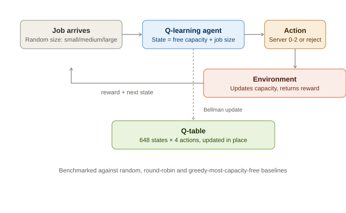
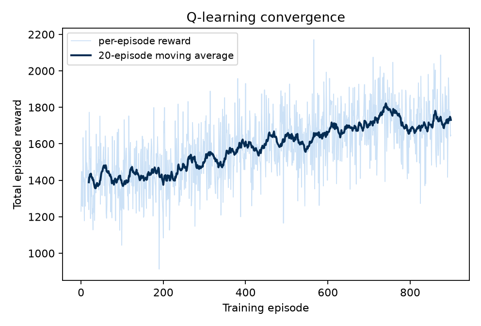
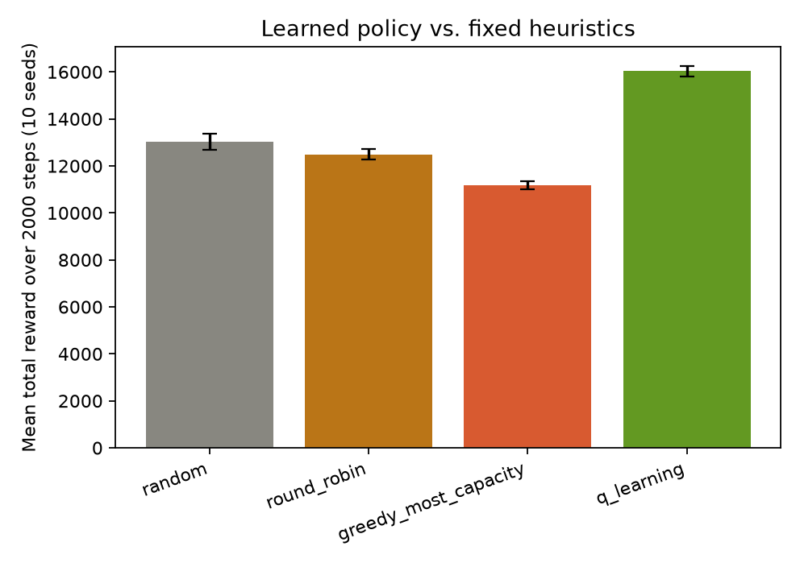
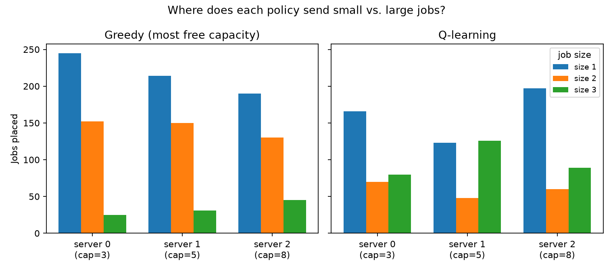

# RLScheduler — tabular Q-learning vs. hand-written scheduling heuristics


A from-scratch (no `gym`, no deep RL framework) tabular Q-learning agent
for dynamic multi-server job scheduling — the same decision every cloud
autoscaler, network slicer, and hospital bed-management system has to
make: *an arriving request has to go somewhere, right now, under capacity
constraints, without knowing what arrives next.* Benchmarked against
three fixed heuristics to answer the question a lot of RL demos skip:
**does the learned policy actually beat a well-designed heuristic, or
just a strawman?**



## Quickstart

```bash
python -m venv .venv && source .venv/bin/activate
pip install -e ".[dev]"
python experiments/run_experiment.py   # ~20s — regenerates everything below
pytest -q                              # 7 tests
```

```python
from rlscheduler.agents import QLearningAgent
from rlscheduler.env import SchedulerEnv

agent = QLearningAgent(capacities=(3, 5, 8))   # a small, medium and large server
agent.train(n_episodes=900, steps_per_episode=200)

env = SchedulerEnv(capacities=(3, 5, 8), seed=1)
total_reward = agent.run_greedy(env, steps=2000)
```

## The setup

Three heterogeneous servers (capacity 3, 5, 8). Jobs arrive one at a
time with a random size (small/medium/large) and a value that's
**disproportionately higher for large jobs** (5 / 12 / 45) — so failing
to place a large job because its capacity got used up by small jobs is
expensive. Capacity regenerates stochastically as jobs complete. The
agent sees `(free_0, free_1, free_2, job_size)` and chooses a server or
rejects. 648 reachable states, 4 actions — small enough for an exact
tabular Q-table, no function approximation needed.

## Results (real numbers from the committed experiment, 10 eval seeds × 2,000 steps)

| Policy | Mean total reward | vs. best baseline |
|---|---|---|
| Greedy (always pick server with most free capacity) | 11,182 ± 180 | — |
| Round-robin | 12,484 ± 224 | — |
| Random | 13,029 ± 332 | — |
| **Q-learning (trained, 900 episodes)** | **16,028 ± 227** | **+23.0%** |

**The honest surprise:** the "obviously reasonable" greedy heuristic —
always send the job to whichever server currently has the most free
capacity — is the *worst* baseline here, worse even than random. It's
myopic: it keeps dumping small jobs onto the big server just because the
big server usually looks most free *right now*, leaving no room when a
genuinely valuable large job arrives. Q-learning, trained with no
hand-coded notion of "reserve capacity for big jobs," discovers exactly
that policy on its own by backing up future reward through the Bellman
equation — it learns to route small jobs *away* from the big server even
when greedy says the big server is the obvious choice.

| Learning curve | Policy comparison |
|---|---|
|  |  |

The placement breakdown makes the learned strategy concrete: Q-learning
sends nearly **2× as many large jobs** to the big server (cap=8) as the
greedy heuristic does (89 vs. 45 over 2,000 steps), by proactively
routing small/medium jobs to the smaller servers instead.



## Repository layout

```
src/rlscheduler/
├── env.py      custom multi-server scheduling environment (no gym dependency)
└── agents.py   QLearningAgent (tabular, Bellman updates) + random/round-robin/greedy baselines
experiments/run_experiment.py   regenerates every number and plot above
tests/                          7 tests — environment transitions, learning progress, baseline comparison
```

## Limitations

- Tabular Q-learning only scales to small, discretized state spaces
  (here, 648 states). A continuous or high-dimensional version of this
  problem would need function approximation (DQN-style), a deliberate
  scope boundary to keep every number in this repo exactly reproducible
  without a deep learning framework.
- A single, fixed reward structure (job values 5/12/45) is studied. The
  qualitative finding — greedy-by-current-capacity is myopic, a learned
  policy can reserve headroom for high-value future arrivals — is general;
  the exact 23% improvement number is specific to this reward design.
- Job arrivals are i.i.d. and capacity regeneration is memoryless
  (geometric); a production scheduler would need to handle
  non-stationary, bursty arrival patterns.

## License

[MIT](LICENSE)

## Author

**Thakur Ajay Kumar** — [Portfolio](https://trajay450.github.io/ajaytr/) · [GitHub](https://github.com/trajay450) · [LinkedIn](https://www.linkedin.com/in/ajay-kumar-thakur-aa7b96444/)
